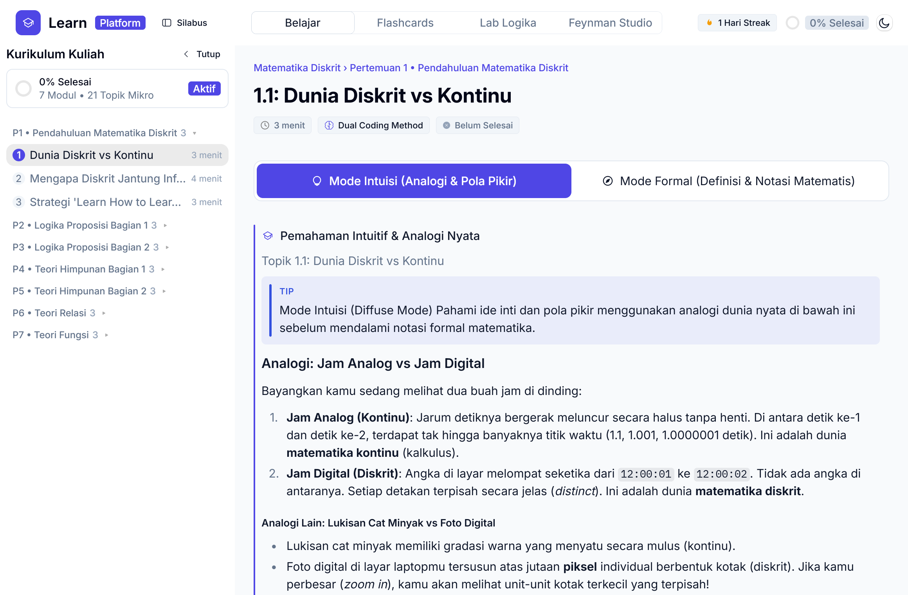

# Learn 🚀
> Platform Belajar Interaktif berbasis **"Learn How to Learn"** (Cognitive Science) & Framework UI GPU **`anomalyco/rune`** (OpenCode).

Dibuat dengan arsitektur modular untuk mendukung berbagai kurikulum sains & komputasi (dimulai dari kurikulum lengkap Matematika Diskrit UDINUS, Pak Erwin Hidayat).



---

## 🧠 Konsep Pedagogi: "Learn How to Learn"

Platform ini tidak sekadar menampilkan teks kuliah biasa, melainkan menerapkan 6 pilar ilmu kognitif modern:

1. **Chunking (Pecah Modul Mikro)**:
   - Setiap pertemuan (Pertemuan 1 sampai 7) dipecah menjadi 3 sub-modul mikro berdurasi 3–5 menit baca agar tidak memicu kelelahan kognitif (*cognitive overload*).
2. **Dual-Mode Thinking (Diffuse vs. Focused)**:
   - **💡 Diffuse Mode**: Penjelasan intuisi gambaran besar dengan analogi kehidupan nyata (Feynman/ELI5), contoh: relasi sebagai hubungan pertemanan media sosial, fungsi sebagai mesin vending otomatis.
   - **📐 Focused Mode**: Notasi formal matematika presisi, tabel kebenaran lengkap, dan rumus aljabar.
3. **Active Recall Checkpoints**:
   - Kuis interaktif mini langsung di setiap sub-bab untuk menguji ingatan aktif seketika (mengatasi *illusion of competence* dari membaca pasif).
4. **Spaced Repetition System (SRS Flashcards)**:
   - Dek kartu pengulangan berjarak dengan algoritma Leitner Box (Review Besok, 3 Hari Lagi, 7 Hari Lagi) agar materi terkunci di memori jangka panjang (*Ebbinghaus Forgetting Curve*).
5. **Interactive Sandboxes (Lab Logika & Relasi)**:
   - **Generator & Simulator Tabel Kebenaran**: Toggle variabel $p, q$ dan operator ($\land, \lor, \to, \leftrightarrow, \oplus$) untuk melihat kalkulasi nilai kebenaran dan tabel 4 baris secara dinamis.
   - **Penguji Sifat Relasi Biner**: Klik pasangan terurut pada himpunan $\{1, 2, 3\}$, sistem akan mendeteksi secara instan apakah relasi bersifat **Refleksif**, **Simetris**, **Antisimetris**, atau **Transitif**.
6. **Feynman Studio**:
   - Ruang latihan untuk merumuskan ulang pemahaman konsep menggunakan bahasa sederhana, dilengkapi checklist kata kunci esensial.

---

## 📚 Cakupan Materi (Pertemuan 1 – 7)

- **Modul 1: Pendahuluan Matematika Diskrit**
  - Diskrit vs Kontinu (Jam analog vs jam digital, piksel vs lukisan).
  - Mengapa diskrit adalah jantung komputer & dunia digital (bit 0/1, algoritma, database).
  - Strategi kognitif *Learn How to Learn*.
- **Modul 2: Logika Proposisi Bagian 1**
  - Definisi proposisi deklaratif dan nilai kebenaran T/F.
  - Operator majemuk: Konjungsi ($\land$), Disjungsi ($\lor$), Implikasi ($p \to q$), Biimplikasi ($p \leftrightarrow q$).
  - Analogi kontrak janji implikasi.
  - Kuantor Universal ($\forall$) dan Eksistensial ($\exists$).
  - Tautologi dan Kontradiksi.
- **Modul 3: Logika Proposisi Bagian 2**
  - Hukum De Morgan untuk logika dan tabel kebenaran lengkap.
  - Aturan Inferensi: Modus Ponens, Modus Tollens, Silogisme Hipotesis, Silogisme Disjungtif.
  - Bentuk turunan implikasi: Konvers, Invers, dan Kontraposisi.
- **Modul 4: Teori Himpunan Bagian 1**
  - Definisi himpunan *well-defined* dan 4 cara penyajian (Enumerasi, Set Builder, Simbol Baku, Diagram Venn).
  - Kardinalitas ($|A|$) dan himpunan kosong ($\emptyset$).
  - Himpunan bagian ($\subseteq$), proper subset ($\subset$), dan Himpunan Kuasa (*Power Set*, $2^n$).
- **Modul 5: Teori Himpunan Bagian 2**
  - 5 Operasi himpunan: Irisan ($\cap$), Gabungan ($\cup$), Selisih ($-$), Komplemen ($A^c$), Beda Setangkup ($\oplus$).
  - Hukum aljabar himpunan & Hukum De Morgan himpunan.
  - Prinsip Inklusi-Eksklusi (PIE) untuk 2 dan 3 himpunan.
- **Modul 6: Teori Relasi**
  - Pasangan terurut, perkalian kartesian ($A \times B$), dan definisi relasi biner.
  - 4 Cara representasi: Pasangan terurut, diagram panah, matriks boolean 0/1, graf berarah (*digraph*).
  - 4 Sifat relasi utama: Refleksif, Simetris, Antisimetris, Transitif.
  - Relasi invers ($R^{-1}$) dan komposisi relasi ($R \circ S$).
- **Modul 7: Teori Fungsi**
  - Definisi fungsi, domain, kodomain, dan range (analogi mesin vending).
  - 3 Jenis fungsi: Injektif (*One-to-One*), Surjektif (*Onto*), Bijektif (*Korespondensi Satu-ke-Satu*).
  - Syarat mutlak keberadaan fungsi invers ($f^{-1}$) dan komposisi fungsi ($f \circ g$).

---

## 🚀 Cara Menjalankan Aplikasi

Aplikasi memiliki **Dual-Target** (bisa dijalankan sebagai Native Desktop Linux dan Web Browser WebGPU):

### 1. Menjalankan Versi Native Desktop (Sangat Halus 60–120 FPS)
```bash
./scripts/run-desktop.sh
# atau langsung dengan cargo:
cargo +nightly run
```

### 2. Menjalankan Versi Web Browser (WebAssembly + WebGPU Canvas)
```bash
./scripts/serve-web.sh
```
Lalu buka browser di alamat:
👉 **`http://localhost:8000`**

*(Gunakan browser modern yang mendukung WebGPU seperti Chrome 113+, Edge 113+, atau Firefox).*

### 3. Membangun Ulang Versi Web (Jika Melakukan Perubahan Kode)
```bash
./scripts/build-web.sh
```

### 4. Mengambil Snapshot Headless (Render ke PNG Otomatis)
Aplikasi Rune mendukung snapshot headless langsung ke GPU:
```bash
# Snapshot Tab Belajar (Default: Modern Web Clean Light Mode)
cargo +nightly run -- --snap preview.png

# Snapshot Modern Slate Dark Mode
cargo +nightly run -- --snap preview-dark.png --scene dark

# Snapshot Tab Lab Logika Interaktif
cargo +nightly run -- --snap preview-lab.png --scene lab

# Snapshot Tab Flashcards Spaced Repetition
cargo +nightly run -- --snap preview-flashcards.png --scene flashcards

# Snapshot Tab Feynman Studio
cargo +nightly run -- --snap preview-feynman.png --scene feynman
```

---

## 🛠️ Struktur Direktori Proyek

```text
/home/thirafi/project/learn
├── Cargo.toml                  # Manifest dependensi Rust & patch Rune
├── preview.png                 # Snapshot tampilan web modern (Clean Light)
├── preview-dark.png            # Snapshot tampilan web modern (Slate Dark)
├── preview-lab.png             # Snapshot lab logika & relasi
├── preview-flashcards.png      # Snapshot flashcard SRS
├── preview-feynman.png         # Snapshot studio Feynman
├── scripts/
│   ├── run-desktop.sh          # Peluncur aplikasi desktop
│   ├── build-web.sh            # Kompilator wasm-bindgen web
│   └── serve-web.sh            # Peluncur web server lokal (localhost:8000)
├── target/
│   └── web/                    # Bundle web siap saji (app_bg.wasm, app.js, index.html)
└── src/
    ├── main.rs                 # Entrypoint native desktop
    ├── lib.rs                  # Entrypoint WebAssembly (wasm-bindgen start)
    ├── theme.rs                # Sistem token desain Web (Modern Light & Slate Dark)
    ├── state.rs                # App state (kuis, flashcards SRS, lab, streak, theme)
    ├── curriculum/             # Modul materi Pertemuan 1 - 7 & Flashcards
    │   ├── mod.rs
    │   ├── modul1_pendahuluan.rs
    │   ├── modul2_logika.rs
    │   ├── modul3_inferensi.rs
    │   ├── modul4_himpunan.rs
    │   ├── modul5_operasi_himpunan.rs
    │   ├── modul6_relasi.rs
    │   ├── modul7_fungsi.rs
    │   └── flashcards.rs
    └── views/                  # Komponen antarmuka Rune UI Web
        ├── mod.rs
        ├── navbar.rs           # Top navbar modern web (tabs, streak, progress, theme toggle)
        ├── sidebar.rs          # Drawer silabus perkuliahan & pelacak progres
        ├── lesson.rs           # Viewer materi, mode diffuse/focused, active recall
        ├── lab.rs              # Lab tabel kebenaran dinamis & penguji sifat relasi
        ├── srs.rs              # Deck flashcards pengulangan berjarak Leitner
        └── feynman.rs          # Feynman studio editor
```
